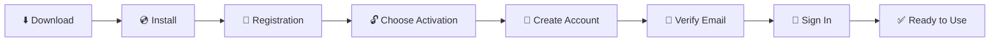

# 📊 Tableau Desktop Installation and Getting Started Guide

🌐 **Language:** [TH ไทย](README.md) | **US English** | [JP 日本語](README.ja.md)

> Download, install, create a Tableau Account with your email, and activate Tableau Desktop to start analyzing data on your own computer.

🗓️ **Last updated:** October 15, 2026

> [!NOTE]
> **⚖️ Disclaimer**
>
> This document is a personal compilation intended for knowledge-sharing purposes only. It is not official documentation from the product owner and shall not be used as a commercial reference. Please verify all information against the product owner's official website before use.

---

## 🧭 Table of Contents

| Step | Topic |
|:---:|---|
| 0️⃣ | [What You Need](#0️⃣-what-you-need) |
| 1️⃣ | [Download the Installer](#1️⃣-download-the-installer) |
| 2️⃣ | [Install Tableau Desktop](#2️⃣-install-tableau-desktop) |
| 3️⃣ | [User Registration](#3️⃣-user-registration) |
| 4️⃣ | [Choose an Activation Method](#4️⃣-choose-an-activation-method) |
| 5️⃣ | [Create a Tableau Account with Your Email](#5️⃣-create-a-tableau-account-with-your-email) |
| 6️⃣ | [Verify Your Email](#6️⃣-verify-your-email) |
| 7️⃣ | [Sign In and Complete Activation](#7️⃣-sign-in-and-complete-activation) |
| 🛠️ | [Troubleshooting](#️-troubleshooting) |

---

## 🗺️ Process Overview

---

## 0️⃣ What You Need

| Item | Details |
|---|---|
| 💻 Computer | Windows 10/11 (64-bit) or macOS |
| 🔑 Admin rights | Administrator privileges are required to install the software |
| 📧 Valid email address | Used to create your Tableau Account and receive the verification link |
| 🌐 Internet connection | Required for both download and activation |

---

## 1️⃣ Download the Installer

1. Go to 👉 **[tableau.com/products/desktop/download](https://www.tableau.com/products/desktop/download)**
2. Fill in the form (email, name, company) and click **Download**
3. The installer will download, e.g. `TableauDesktop-64bit-2026-2-3.exe` (Windows) or `.dmg` (macOS)

> [!NOTE]
> If you need a specific version, download it from [Tableau Desktop Release Notes / All Versions](https://www.tableau.com/support/releases)

---

## 2️⃣ Install Tableau Desktop

1. Double-click the downloaded installer
2. Check ☑️ **I have read and accept the terms of the license agreement**
3. *(Optional)* Check ☑️ **Don't send product usage data** if you do not want to share usage data with Tableau
4. Click **Install** *(or **Customize** to change the installation folder)*

5. Wait for the installation to finish (about 3–5 minutes)

> [!IMPORTANT]
> If Windows shows a **User Account Control (UAC)** prompt, click **Yes** to allow the installation.

---

## 3️⃣ User Registration

When installation is complete, Tableau Desktop opens automatically (or open it from the Start Menu).

Fill in every field on the **Registration** screen.

| Field | Example |
|---|---|
| First Name | Somchai |
| Last Name | Demo |
| Organization | Demo Company |
| Email | your.name@company.com |
| Country/Region | Thailand |
| Company Size | 21 – 200 employees |

Then click **Register**.

When ✅ **Registration completed.** appears, click **Continue**.

---

## 4️⃣ Choose an Activation Method

The **Activate Tableau** screen offers three options. Click the **first option (top)** to sign in with a Tableau Account and start using the product right away.

| Option | Use when |
|---|---|
| 1️⃣ First option (top) | ✅ **Choose this** to sign in with a Tableau Account and get started |
| 🔑 Activate with product key | You already have a license Product Key |
| ☁️ Activate by signing in to a server | Your organization uses Tableau Server / Tableau Cloud with login-based licensing |

> [!TIP]
> If your organization already has a **Product Key** or uses **Tableau Server / Tableau Cloud**, choose option 2 or 3 and skip steps 5–6.

---

## 5️⃣ Create a Tableau Account with Your Email

The **Sign In** screen appears.

- **Already have a Tableau Account?** → Enter your Email + Password, click **SIGN IN**, and skip to [Step 7](#7️⃣-sign-in-and-complete-activation)
- **Don't have one yet?** → Click **CREATE AN ACCOUNT**

Fill in the **Create your Tableau Account** form:

1. First Name
2. Last Name
3. Email
4. Password
5. Confirm Password

Then click **CREATE MY ACCOUNT**.

> [!WARNING]
> **Password requirements** (the account cannot be created unless all are met)
>
> | Requirement | |
> |---|---|
> | Length | 8–100 characters (case-sensitive) |
> | Number | At least 1 (0–9) |
> | Uppercase letter | At least 1 (A–Z) |
> | Lowercase letter | At least 1 (a–z) |
> | Special character | At least 1, e.g. `! # $ % & * @ ? _ ~` |
>
> Example of a valid password: `Tableau@2026`

Once the account is created, a message confirms that a verification email has been sent.

---

## 6️⃣ Verify Your Email

1. Open the inbox of the email address you registered with
2. Find the email titled **Tableau Software Account Activation** from `reghelp@tableau.com`
3. Click the link in the email to verify your account

> [!CAUTION]
> The link in the email **expires within 48 hours**. If it has expired, request a new one at [id.tableau.com/resetPassword](https://id.tableau.com/resetPassword)

> [!NOTE]
> If this email address **has registered with Tableau before**, the email will say *"It seems you already have an account with us"* (as shown above). You do not need a new account — go back and **SIGN IN** with your existing password, or click the link in the email to **reset your password**.

> [!TIP]
> Can't find the email? Check your **Spam / Junk / Promotions** folder and add `tableau.com` as a Safe Sender.

---

## 7️⃣ Sign In and Complete Activation

1. Return to the **Sign In** screen in Tableau Desktop
2. Enter the **Email** and **Password** you just created and click **SIGN IN**
3. When ✅ *Thank you for using Tableau Desktop...* appears, click **Continue**

🎉 You are now on the Tableau Desktop Start Page and ready to go. Connect to your data from the **Connect** pane on the left (Excel, Text, PostgreSQL, Vertica, and more).

---

## 🛠️ Troubleshooting

| Problem | Solution |
|---|---|
| ❌ Account creation fails | Make sure the password meets all requirements (number + uppercase + lowercase + special character, 8+ characters) |
| 📭 Verification email not received | Check Spam / Promotions, wait 5–10 minutes, or request a new link at [id.tableau.com/resetPassword](https://id.tableau.com/resetPassword) |
| 🔁 Email says *"already have an account"* | This email is already registered. Sign in with your existing password or use the link in the email to reset it |
| ⏰ Email link doesn't work | The link has expired (48 hours). Request a new one at [id.tableau.com/resetPassword](https://id.tableau.com/resetPassword) |
| 🌐 Sign-in hangs or shows an error | Check your internet connection, proxy, or corporate firewall — `*.tableau.com` must be reachable |
| 🔒 Installation fails | Administrator rights are required. Contact your company's IT team |

---

## 🔗 Related Links

- ⬇️ [Download Tableau Desktop](https://www.tableau.com/products/desktop/download)
- 📦 [All Tableau Desktop Versions (Release Notes)](https://www.tableau.com/support/releases)
- 🔑 [Tableau ID / Reset Password](https://id.tableau.com/resetPassword)

---

[⬆️ Back to top](#-tableau-desktop-installation-and-getting-started-guide)

> [!NOTE]
> **⚖️ Disclaimer**
>
> This document is a personal compilation intended for knowledge-sharing purposes only. It is not official documentation from the product owner and shall not be used as a commercial reference. Please verify all information against the product owner's official website before use.

**Created by The Narit Lab**
