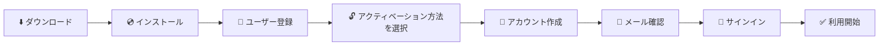

# 📊 Tableau Desktop インストールガイド

🌐 **Language:** [TH ไทย](README.md) | [US English](README.en.md) | **JP 日本語**

> Tableau Desktop のダウンロード、インストール、メールアドレスでの Tableau アカウント作成、アクティベーションまでを行い、ご自身のパソコンでデータ分析を始めましょう。

🗓️ **最終更新日:** 2026年10月15日

> [!NOTE]
> **⚖️ 免責事項 (Disclaimer)**
>
> 本書は、著者が個人的に収集した情報をもとに、知識共有のみを目的として作成したものです。製品提供元の公式ドキュメントではなく、商業上の参考資料として使用することはできません。情報を参照される際は、必ず製品提供元の公式ウェブサイトで最新情報をご確認ください。
>
> *This document is a personal compilation intended for knowledge-sharing purposes only. It is not official documentation from the product owner and shall not be used as a commercial reference. Please verify all information against the product owner's official website before use.*

---

## 🧭 目次

| ステップ | 内容 |
|:---:|---|
| 0️⃣ | [事前準備](#0️⃣-事前準備) |
| 💻 | [推奨 PC スペック (Notebook Specification)](#-推奨-pc-スペック-notebook-specification) |
| 1️⃣ | [インストーラーのダウンロード](#1️⃣-インストーラーのダウンロード) |
| 2️⃣ | [Tableau Desktop のインストール](#2️⃣-tableau-desktop-のインストール) |
| 3️⃣ | [ユーザー登録 (Registration)](#3️⃣-ユーザー登録-registration) |
| 4️⃣ | [アクティベーション方法の選択](#4️⃣-アクティベーション方法の選択) |
| 5️⃣ | [メールで Tableau アカウントを作成](#5️⃣-メールで-tableau-アカウントを作成) |
| 6️⃣ | [メールアドレスの確認](#6️⃣-メールアドレスの確認) |
| 7️⃣ | [サインインとアクティベーション完了](#7️⃣-サインインとアクティベーション完了) |
| 🛠️ | [よくある問題と対処法](#️-よくある問題と対処法) |

---

## 🗺️ 全体の流れ

---

## 0️⃣ 事前準備

| 項目 | 詳細 |
|---|---|
| 💻 パソコン | Windows 10/11 (64-bit) または macOS |
| 🔑 管理者権限 | ソフトウェアのインストールには Administrator 権限が必要です |
| 📧 有効なメールアドレス | Tableau アカウントの作成と確認リンクの受信に使用します |
| 🌐 インターネット接続 | ダウンロード時とアクティベーション時に必要です |

### 💻 推奨 PC スペック (Notebook Specification)

#### 🪟 Windows

| 項目 | 最小要件 (Minimum) | 推奨 (Recommended) |
|---|---|---|
| OS | Windows 10 (64-bit) | Windows 11 (64-bit) |
| CPU | Intel Core i3 / AMD Ryzen 3 (Dual Core) | Intel Core i7 / AMD Ryzen 7 (Quad Core) 以上 |
| メモリ (RAM) | 4 GB | 16 GB 以上 |
| ディスク空き容量 | 2 GB (HDD) | 2 GB 以上 (SSD) |
| CPU 命令セット | SSE4.2 および POPCNT に対応していること | SSE4.2 および POPCNT に対応していること |

#### 🍎 macOS

| 項目 | 最小要件 (Minimum) | 推奨 (Recommended) |
|---|---|---|
| OS | macOS Ventura | macOS Sonoma / Sequoia / Tahoe *（Tahoe は Tableau 2026.1 以降で対応）* |
| CPU | Intel Core i3 (Dual Core) または Apple Silicon | Apple Silicon (M シリーズ) または Intel Core i7 (Quad Core) |
| メモリ (RAM) | 4 GB | 16 GB 以上 |
| ディスク空き容量 | 2 GB (HDD) | 2 GB 以上 (SSD) |

> [!TIP]
> **お使いの PC のスペック確認方法**
> - **Windows:** `Windows + Pause/Break` キーを押すか、**設定 ▸ システム ▸ バージョン情報** を開きます
> - **macOS:**  メニュー ▸ **この Mac について** をクリックします
>
> Tableau はデータをメモリ上で処理するため、**16 GB の RAM と SSD** を推奨します。データ量が多いほど多くのメモリが必要になります。

> [!NOTE]
> - 一部のコネクタは Windows 専用です（Microsoft Access や一部の SAP コネクタなど）。また、Apple Silicon では未対応のコネクタもあります。特定のデータベースに接続する場合は、PC を選ぶ前にご確認ください。
> - 仮想環境（Citrix、Hyper-V、VMware、Parallels）へのインストールにも対応しています。その際は **Processor Compatibility mode** を無効にしてください。
>
> 参考：[Tableau Technical Specifications](https://www.tableau.com/products/techspecs)

---

## 1️⃣ インストーラーのダウンロード

1. 👉 **[tableau.com/products/desktop/download](https://www.tableau.com/products/desktop/download)** にアクセスします
2. フォーム（メールアドレス、氏名、会社名）に入力し、**Download** をクリックします
3. インストーラーがダウンロードされます（例：`TableauDesktop-64bit-2026-2-3.exe`（Windows）または `.dmg`（macOS））

> [!NOTE]
> 特定のバージョンが必要な場合は、[Tableau Desktop Release Notes / All Versions](https://www.tableau.com/support/releases) からダウンロードできます。

---

## 2️⃣ Tableau Desktop のインストール

1. ダウンロードしたインストーラーをダブルクリックします
2. ☑️ **I have read and accept the terms of the license agreement** にチェックを入れます
3. *（任意）* 利用状況データを Tableau に送信したくない場合は ☑️ **Don't send product usage data** にチェックを入れます
4. **Install** をクリックします *（インストール先フォルダーを変更する場合は **Customize**）*

5. インストールが完了するまで待ちます（約 3〜5 分）

> [!IMPORTANT]
> Windows の **ユーザーアカウント制御（UAC）** が表示された場合は、**はい（Yes）** をクリックしてインストールを許可してください。

---

## 3️⃣ ユーザー登録 (Registration)

インストールが完了すると、Tableau Desktop が自動的に起動します（またはスタートメニューから起動します）。

**Registration** 画面のすべての項目に入力します。

| 項目 | 入力例 |
|---|---|
| First Name | Somchai |
| Last Name | Demo |
| Organization | Demo Company |
| Email | your.name@company.com |
| Country/Region | Thailand |
| Company Size | 21 – 200 employees |

入力後、**Register** をクリックします。

✅ **Registration completed.** と表示されたら **Continue** をクリックします。

---

## 4️⃣ アクティベーション方法の選択

**Activate Tableau** 画面に 3 つの選択肢が表示されます。**Use Tableau for free** をクリックすると、Tableau アカウントでサインインしてすぐに利用を開始できます。

| 選択肢 | 使用するケース |
|---|---|
| 1️⃣ Use Tableau for free | ✅ **こちらを選択** — Tableau アカウントでサインインして利用開始 |
| 🔑 Activate with product key | ライセンスの Product Key をお持ちの場合 |
| ☁️ Activate by signing in to a server | 組織で Tableau Server / Tableau Cloud のログインベースライセンスを利用している場合 |

> [!TIP]
> 組織ですでに **Product Key** をお持ちの場合や **Tableau Server / Tableau Cloud** をご利用の場合は、2 番目または 3 番目の選択肢を選び、ステップ 5〜6 は省略できます。

---

## 5️⃣ メールで Tableau アカウントを作成

**Sign In** 画面が表示されます。

- **Tableau アカウントをお持ちの場合** → Email と Password を入力して **SIGN IN** をクリックし、[ステップ 7](#7️⃣-サインインとアクティベーション完了) へ進みます
- **お持ちでない場合** → **CREATE AN ACCOUNT** をクリックします

**Create your Tableau Account** 画面に以下を入力します。

1. First Name
2. Last Name
3. Email
4. Password
5. Confirm Password

入力後、**CREATE MY ACCOUNT** をクリックします。

> [!WARNING]
> **パスワードの条件**（すべて満たさないとアカウントを作成できません）
>
> | 条件 | |
> |---|---|
> | 長さ | 8〜100 文字（大文字・小文字を区別） |
> | 数字 | 1 文字以上（0〜9） |
> | 大文字 | 1 文字以上（A〜Z） |
> | 小文字 | 1 文字以上（a〜z） |
> | 記号 | 1 文字以上（例：`! # $ % & * @ ? _ ~`） |
>
> 条件を満たすパスワードの例：`Tableau@2026`

アカウントが作成されると、確認メールを送信した旨のメッセージが表示されます。

---

## 6️⃣ メールアドレスの確認

1. 登録したメールアドレスの受信トレイを開きます
2. `reghelp@tableau.com` から届いた件名 **Tableau Software Account Activation** のメールを探します
3. メール内のリンクをクリックしてアカウントを確認します

> [!CAUTION]
> メール内のリンクは **48 時間で有効期限が切れます**。期限切れの場合は [id.tableau.com/resetPassword](https://id.tableau.com/resetPassword) から新しいリンクを請求してください。

> [!NOTE]
> このメールアドレスで **以前に Tableau へ登録したことがある** 場合、メールには *"It seems you already have an account with us"* と記載されます（上の画像のとおり）。新しいアカウントは不要です。既存のパスワードで **SIGN IN** するか、メール内のリンクから **パスワードを再設定** してください。

> [!TIP]
> メールが見つからない場合は、**迷惑メール / Junk / プロモーション** フォルダーを確認し、`tableau.com` を安全な送信者に追加してください。

---

## 7️⃣ サインインとアクティベーション完了

1. Tableau Desktop の **Sign In** 画面に戻ります
2. 作成した **Email** と **Password** を入力し、**SIGN IN** をクリックします
3. ✅ *Thank you for using Tableau Desktop...* と表示されたら **Continue** をクリックします

🎉 Tableau Desktop のスタートページが表示され、利用可能になりました。左側の **Connect** ペインからデータに接続できます（Excel、Text、PostgreSQL、Vertica など）。

---

## 🛠️ よくある問題と対処法

| 問題 | 対処法 |
|---|---|
| ❌ アカウントを作成できない | パスワードがすべての条件（数字＋大文字＋小文字＋記号、8 文字以上）を満たしているか確認してください |
| 📭 確認メールが届かない | 迷惑メール / プロモーションを確認し、5〜10 分待つか、[id.tableau.com/resetPassword](https://id.tableau.com/resetPassword) から再請求してください |
| 🔁 メールに *"already have an account"* と表示される | このメールアドレスは登録済みです。既存のパスワードでサインインするか、メール内のリンクからパスワードを再設定してください |
| ⏰ メール内のリンクが使えない | リンクの有効期限（48 時間）が切れています。[id.tableau.com/resetPassword](https://id.tableau.com/resetPassword) から再請求してください |
| 🌐 サインインが止まる / エラーになる | インターネット接続、プロキシ、社内ファイアウォールを確認してください。`*.tableau.com` へのアクセスが必要です |
| 🔒 インストールできない | Administrator 権限が必要です。社内の IT 部門にお問い合わせください |

---

## 🔗 関連リンク

- ⬇️ [Tableau Desktop のダウンロード](https://www.tableau.com/products/desktop/download)
- 📦 [Tableau Desktop 全バージョン（Release Notes）](https://www.tableau.com/support/releases)
- 💻 [Tableau Technical Specifications（動作環境）](https://www.tableau.com/products/techspecs)
- 🔑 [Tableau ID / パスワード再設定](https://id.tableau.com/resetPassword)

---

[⬆️ ページの先頭へ戻る](#-tableau-desktop-インストールガイド)

> [!NOTE]
> **⚖️ 免責事項 (Disclaimer)**
>
> 本書は、著者が個人的に収集した情報をもとに、知識共有のみを目的として作成したものです。製品提供元の公式ドキュメントではなく、商業上の参考資料として使用することはできません。情報を参照される際は、必ず製品提供元の公式ウェブサイトで最新情報をご確認ください。
>
> *This document is a personal compilation intended for knowledge-sharing purposes only. It is not official documentation from the product owner and shall not be used as a commercial reference. Please verify all information against the product owner's official website before use.*

**Created by The Narit Lab**
