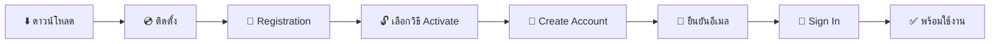
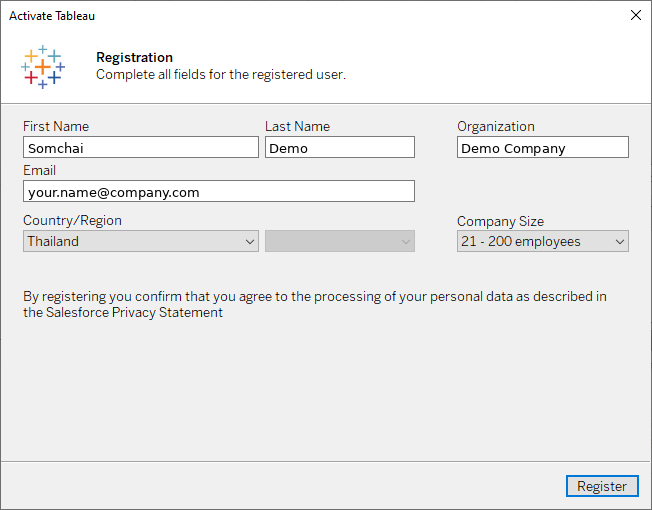
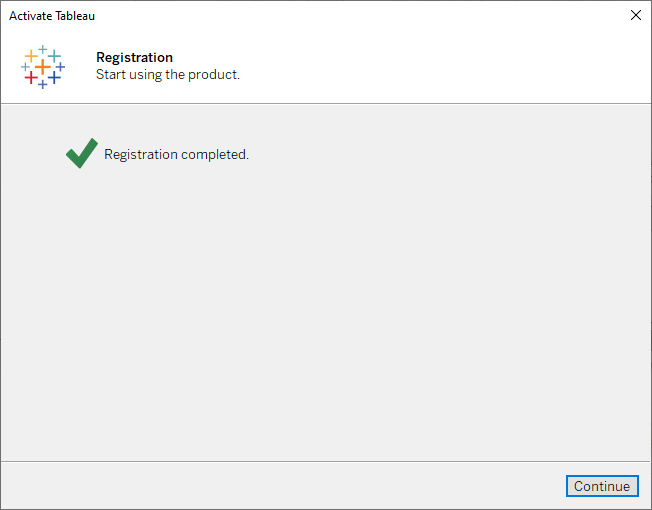
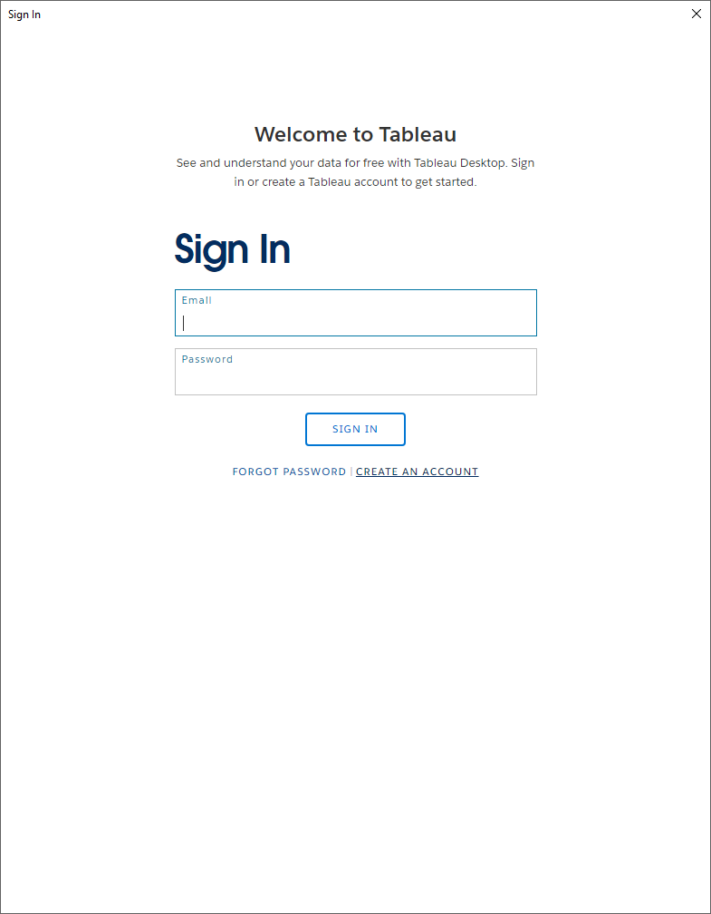
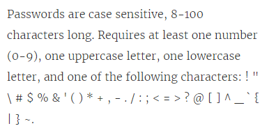
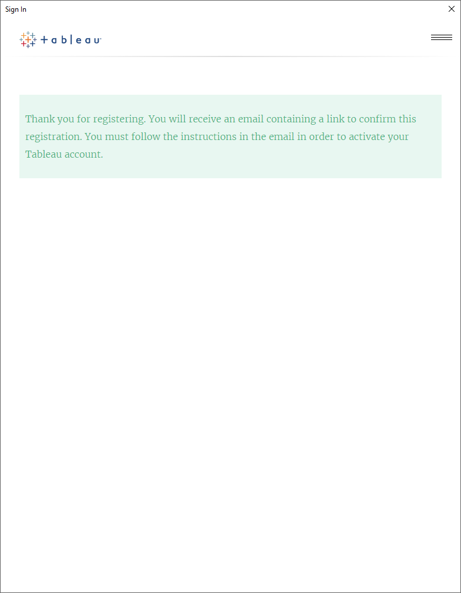
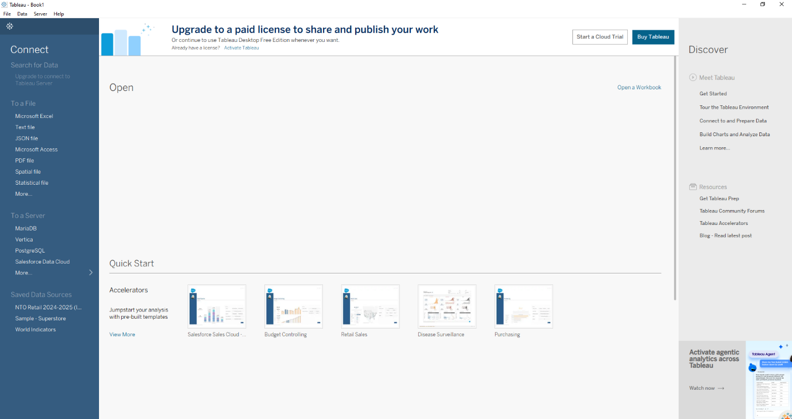

# 📊 คู่มือติดตั้งและเริ่มต้นใช้งาน Tableau Desktop

🌐 **Language:** **TH ไทย** | [US English](README.en.md) | [JP 日本語](README.ja.md)

> ดาวน์โหลด ติดตั้ง สร้าง Tableau Account ด้วยอีเมล และ Activate Tableau Desktop เพื่อเริ่มวิเคราะห์ข้อมูลบนเครื่องของคุณ

🗓️ **อัปเดตล่าสุด:** 15 ตุลาคม 2026

> [!NOTE]
> **⚖️ ข้อจำกัดความรับผิดชอบ (Disclaimer)**
>
> เอกสารนี้จัดทำขึ้นจากการรวบรวมข้อมูลโดยส่วนตัวของผู้เขียน เพื่อวัตถุประสงค์ในการแบ่งปันความรู้เท่านั้น มิใช่เอกสารทางการของเจ้าของผลิตภัณฑ์ และไม่สามารถใช้เป็นเอกสารอ้างอิงทางการค้าได้ หากต้องการนำข้อมูลไปใช้อ้างอิง กรุณาตรวจสอบข้อมูลล่าสุดจากเว็บไซต์ทางการของเจ้าของผลิตภัณฑ์อีกครั้ง
>
> *This document is a personal compilation intended for knowledge-sharing purposes only. It is not official documentation from the product owner and shall not be used as a commercial reference. Please verify all information against the product owner's official website before use.*

---

## 🧭 สารบัญ

| ขั้นตอน | หัวข้อ |
|:---:|---|
| 0️⃣ | [สิ่งที่ต้องเตรียม](#0️⃣-สิ่งที่ต้องเตรียม) |
| 1️⃣ | [ดาวน์โหลดตัวติดตั้ง](#1️⃣-ดาวน์โหลดตัวติดตั้ง) |
| 2️⃣ | [ติดตั้ง Tableau Desktop](#2️⃣-ติดตั้ง-tableau-desktop) |
| 3️⃣ | [ลงทะเบียนผู้ใช้ (Registration)](#3️⃣-ลงทะเบียนผู้ใช้-registration) |
| 4️⃣ | [เลือกวิธี Activate](#4️⃣-เลือกวิธี-activate) |
| 5️⃣ | [สร้าง Tableau Account ด้วยอีเมล](#5️⃣-สร้าง-tableau-account-ด้วยอีเมล) |
| 6️⃣ | [ยืนยันอีเมล](#6️⃣-ยืนยันอีเมล) |
| 7️⃣ | [Sign In และ Activate สำเร็จ](#7️⃣-sign-in-และ-activate-สำเร็จ) |
| 🛠️ | [แก้ปัญหาที่พบบ่อย](#️-แก้ปัญหาที่พบบ่อย) |

---

## 🗺️ ภาพรวมขั้นตอน

---

## 0️⃣ สิ่งที่ต้องเตรียม

| รายการ | รายละเอียด |
|---|---|
| 💻 เครื่องคอมพิวเตอร์ | Windows 10/11 (64-bit) หรือ macOS |
| 🔑 สิทธิ์ผู้ดูแลเครื่อง | ต้องมีสิทธิ์ Administrator เพื่อติดตั้งโปรแกรม |
| 📧 อีเมลที่ใช้งานได้ | ใช้สร้าง Tableau Account และรับลิงก์ยืนยัน |
| 🌐 อินเทอร์เน็ต | ใช้ทั้งตอนดาวน์โหลดและตอน Activate |

---

## 1️⃣ ดาวน์โหลดตัวติดตั้ง

1. เข้าเว็บไซต์ 👉 **[tableau.com/products/desktop/download](https://www.tableau.com/products/desktop/download)**
2. กรอกข้อมูลในฟอร์ม (อีเมล ชื่อ บริษัท) แล้วกด **Download**
3. ระบบจะดาวน์โหลดไฟล์ติดตั้ง เช่น `TableauDesktop-64bit-2026-2-3.exe` (Windows) หรือ `.dmg` (macOS)

> [!NOTE]
> ถ้าต้องการเวอร์ชันเฉพาะ ดาวน์โหลดได้ที่ [Tableau Desktop Release Notes / All Versions](https://www.tableau.com/support/releases)

---

## 2️⃣ ติดตั้ง Tableau Desktop

1. ดับเบิลคลิกไฟล์ติดตั้งที่ดาวน์โหลดมา
2. ติ๊ก ☑️ **I have read and accept the terms of the license agreement**
3. *(ไม่บังคับ)* ติ๊ก ☑️ **Don't send product usage data** ถ้าไม่ต้องการส่งข้อมูลการใช้งานให้ Tableau
4. กด **Install** *(หรือ **Customize** ถ้าต้องการเปลี่ยนโฟลเดอร์ติดตั้ง)*

5. รอจนติดตั้งเสร็จ (ประมาณ 3–5 นาที)

> [!IMPORTANT]
> ถ้า Windows ถาม **User Account Control (UAC)** ให้กด **Yes** เพื่ออนุญาตการติดตั้ง

---

## 3️⃣ ลงทะเบียนผู้ใช้ (Registration)

เมื่อติดตั้งเสร็จ Tableau Desktop จะเปิดขึ้นมาเอง (หรือเปิดจาก Start Menu)

กรอกข้อมูลในหน้า **Registration** ให้ครบทุกช่อง

| ช่อง | ตัวอย่าง |
|---|---|
| First Name | Somchai |
| Last Name | Demo |
| Organization | Demo Company |
| Email | your.name@company.com |
| Country/Region | Thailand |
| Company Size | 21 – 200 employees |

แล้วกด **Register**

เมื่อขึ้น ✅ **Registration completed.** ให้กด **Continue**

---

## 4️⃣ เลือกวิธี Activate

หน้า **Activate Tableau** จะมีให้เลือก 3 ทาง ให้คลิก **ตัวเลือกแรก (บนสุด)** เพื่อ Sign In ด้วย Tableau Account แล้วเริ่มใช้งานได้ทันที

| ตัวเลือก | ใช้เมื่อ |
|---|---|
| 1️⃣ ตัวเลือกแรก (บนสุด) | ✅ **เลือกอันนี้** เพื่อ Sign In ด้วย Tableau Account และเริ่มใช้งาน |
| 🔑 Activate with product key | มี Product Key ของ License แล้ว |
| ☁️ Activate by signing in to a server | องค์กรใช้ Tableau Server / Tableau Cloud แบบ Login-based License |

> [!TIP]
> ถ้าองค์กรของคุณมี **Product Key** หรือใช้ **Tableau Server / Tableau Cloud** อยู่แล้ว เลือกตัวเลือกที่ 2 หรือ 3 ได้เลย ไม่ต้องทำขั้นตอนที่ 5–6

---

## 5️⃣ สร้าง Tableau Account ด้วยอีเมล

หน้า **Sign In** จะขึ้นมา

- ถ้า **มี Tableau Account อยู่แล้ว** → กรอก Email + Password แล้วกด **SIGN IN** ข้ามไป [ขั้นตอนที่ 7](#7️⃣-sign-in-และ-activate-สำเร็จ) ได้เลย
- ถ้า **ยังไม่มี** → กด **CREATE AN ACCOUNT**

กรอกข้อมูลในหน้า **Create your Tableau Account**

1. First Name
2. Last Name
3. Email
4. Password
5. Confirm Password

แล้วกด **CREATE MY ACCOUNT**

> [!WARNING]
> **เงื่อนไขรหัสผ่าน** (ถ้าไม่ครบจะสร้างบัญชีไม่ได้)
>
> | เงื่อนไข | |
> |---|---|
> | ความยาว | 8–100 ตัวอักษร (ตัวพิมพ์เล็ก-ใหญ่มีผล) |
> | ตัวเลข | อย่างน้อย 1 ตัว (0–9) |
> | ตัวพิมพ์ใหญ่ | อย่างน้อย 1 ตัว (A–Z) |
> | ตัวพิมพ์เล็ก | อย่างน้อย 1 ตัว (a–z) |
> | อักขระพิเศษ | อย่างน้อย 1 ตัว เช่น `! # $ % & * @ ? _ ~` |
>
> ตัวอย่างรหัสที่ผ่าน: `Tableau@2026`

เมื่อสร้างสำเร็จ จะขึ้นข้อความว่าระบบส่งอีเมลยืนยันไปแล้ว

---

## 6️⃣ ยืนยันอีเมล

1. เปิดกล่องจดหมายของอีเมลที่ใช้สมัคร
2. หาอีเมลหัวข้อ **Tableau Software Account Activation** จาก `reghelp@tableau.com`
3. คลิกลิงก์ในอีเมลเพื่อยืนยันบัญชี

> [!CAUTION]
> ลิงก์ในอีเมล **หมดอายุภายใน 48 ชั่วโมง** ถ้าหมดอายุแล้ว ขอลิงก์ใหม่ได้ที่ [id.tableau.com/resetPassword](https://id.tableau.com/resetPassword)

> [!NOTE]
> ถ้าอีเมลนี้ **เคยสมัคร Tableau มาก่อนแล้ว** อีเมลที่ได้จะเขียนว่า *"It seems you already have an account with us"* (ตามภาพด้านบน) แปลว่าไม่ต้องสร้างใหม่ ให้กลับไป **SIGN IN** ด้วยรหัสเดิม หรือกดลิงก์ในอีเมลเพื่อ **ตั้งรหัสผ่านใหม่**

> [!TIP]
> ไม่เจออีเมล? ลองดูในโฟลเดอร์ **Spam / Junk / Promotions** และเพิ่ม `tableau.com` เป็น Safe Sender

---

## 7️⃣ Sign In และ Activate สำเร็จ

1. กลับมาที่ Tableau Desktop หน้า **Sign In**
2. กรอก **Email** และ **Password** ที่เพิ่งสร้าง แล้วกด **SIGN IN**
3. เมื่อขึ้น ✅ *Thank you for using Tableau Desktop...* ให้กด **Continue**

🎉 เข้าสู่หน้า Start Page ของ Tableau Desktop พร้อมใช้งาน เริ่มเชื่อมต่อข้อมูลได้จากแถบ **Connect** ด้านซ้าย (Excel, Text, PostgreSQL, Vertica และอื่น ๆ)

---

## 🛠️ แก้ปัญหาที่พบบ่อย

| ปัญหา | วิธีแก้ |
|---|---|
| ❌ สร้างบัญชีไม่ผ่าน | ตรวจรหัสผ่านให้ครบเงื่อนไข (ตัวเลข + ตัวพิมพ์ใหญ่ + ตัวพิมพ์เล็ก + อักขระพิเศษ, 8 ตัวขึ้นไป) |
| 📭 ไม่ได้รับอีเมลยืนยัน | ดูใน Spam / Promotions รอ 5–10 นาที หรือขอใหม่ที่ [id.tableau.com/resetPassword](https://id.tableau.com/resetPassword) |
| 🔁 อีเมลแจ้งว่า *"already have an account"* | อีเมลนี้เคยสมัครแล้ว ให้ Sign In ด้วยรหัสเดิม หรือกดลิงก์ในอีเมลเพื่อตั้งรหัสใหม่ |
| ⏰ ลิงก์ในอีเมลใช้ไม่ได้ | ลิงก์หมดอายุ (48 ชม.) ขอลิงก์ใหม่ที่ [id.tableau.com/resetPassword](https://id.tableau.com/resetPassword) |
| 🌐 Sign In แล้วค้าง / Error | ตรวจอินเทอร์เน็ต, Proxy หรือ Firewall ของบริษัท ต้องเข้า `*.tableau.com` ได้ |
| 🔒 ติดตั้งไม่ได้ | ต้องใช้สิทธิ์ Administrator ติดต่อ IT ของบริษัท |

---

## 🔗 ลิงก์ที่เกี่ยวข้อง

- ⬇️ [ดาวน์โหลด Tableau Desktop](https://www.tableau.com/products/desktop/download)
- 📦 [Tableau Desktop ทุกเวอร์ชัน (Release Notes)](https://www.tableau.com/support/releases)
- 🔑 [Tableau ID / Reset Password](https://id.tableau.com/resetPassword)

---

[⬆️ กลับไปด้านบน](#-คู่มือติดตั้งและเริ่มต้นใช้งาน-tableau-desktop)

> [!NOTE]
> **⚖️ ข้อจำกัดความรับผิดชอบ (Disclaimer)**
>
> เอกสารนี้จัดทำขึ้นจากการรวบรวมข้อมูลโดยส่วนตัวของผู้เขียน เพื่อวัตถุประสงค์ในการแบ่งปันความรู้เท่านั้น มิใช่เอกสารทางการของเจ้าของผลิตภัณฑ์ และไม่สามารถใช้เป็นเอกสารอ้างอิงทางการค้าได้ หากต้องการนำข้อมูลไปใช้อ้างอิง กรุณาตรวจสอบข้อมูลล่าสุดจากเว็บไซต์ทางการของเจ้าของผลิตภัณฑ์อีกครั้ง
>
> *This document is a personal compilation intended for knowledge-sharing purposes only. It is not official documentation from the product owner and shall not be used as a commercial reference. Please verify all information against the product owner's official website before use.*

**Created by The Narit Lab**
